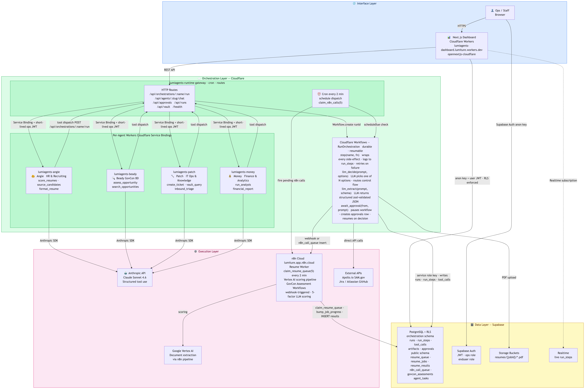

# LumiAgents: AI Department Technical Onboarding

> This document gives new AI department members a complete picture of how the LumiAgents orchestration platform is built, how its components connect, and how we develop and deploy to it. The audience is technical. The focus is the orchestration system; AI agents are a feature built on top of it, not the system itself.

---

## 1. What We Built and Why

Most companies bolt an AI chatbot on top of existing automations and call it done. We went further. LumiAgents is an **agent orchestration platform**: a typed, auditable, resumable workflow engine with LLM-powered decision points embedded in it. Every company workflow (sourcing candidates, scoring résumés, qualifying a government contract) becomes a first-class orchestration: it has typed inputs and outputs, a step-by-step execution log, retry semantics, and human-in-the-loop pause capability.

The key architectural bet: **deterministic workflow spine, LLM at decision points only.** We do not run a general-purpose agent that picks its own tools on every step. Most work is deterministic (query an API, write to the database, call n8n). A narrow subset of steps (routing a free-text request, extracting structured data from a messy document) genuinely need model judgment. We invoke the LLM surgically at those steps. The result is a system you can reason about, replay, and debug.

---

## 2. System Architecture



### Layer model

```
┌──────────────────────────────────────────────────────┐
│  Interface Layer                                     │
│  Next.js dashboard → Cloudflare Workers              │
│  Ops surface (runs, logs, approvals, infra)          │
│  Agent chat (Angie, Beady, Cleo, Dewey, Patch, Money)│
└──────────────────────────────────────────────────────┘
                          │
                          ▼
┌──────────────────────────────────────────────────────┐
│  Orchestration Layer  ← this repo                    │
│  lumiagents-runtime   Cloudflare Workers gateway     │
│  lumiagents-angie     Agent Worker (Service Binding) │
│  lumiagents-beady     Agent Worker (Service Binding) │
│  lumiagents-patch     Agent Worker (Service Binding) │
│  lumiagents-money     Agent Worker (Service Binding) │
│  lumiagents-cleo      Agent Worker (Service Binding) │
│  lumiagents-dewey     Agent Worker (Service Binding) │
│  Cloudflare Workflows  Durable multi-step execution  │
└──────────────────────────────────────────────────────┘
              │                        │
    ┌─────────┘                        └─────────┐
    ▼                                            ▼
┌──────────────────────┐        ┌───────────────────────┐
│  Execution Layer     │        │  Data Layer            │
│  n8n Cloud           │        │  Supabase (Postgres)   │
│  Anthropic Claude    │        │  runs, run_steps       │
│  SAM.gov API         │        │  tool_calls, artifacts │
│  Apollo.io API       │        │  approvals, auth, RLS  │
│  Jira / Teams        │        └───────────────────────┘
└──────────────────────┘
```

### Request path: dashboard chat → orchestration run

```
Browser
  → POST /api/agents/angie/chat        (lumiagents-runtime)
  → Service Binding call               (lumiagents-angie Worker)
  → LLM decides which tool to call
  → POST /api/orchestrations/<name>/run (back to runtime)
  → Cloudflare Workflow launched
  → Steps execute: Supabase writes, n8n webhooks, Anthropic calls
  → Run status streams back to dashboard via Supabase Realtime
```

---

## 3. Technology Stack

### Cloudflare Workers + Workflows

The runtime runs entirely on Cloudflare's edge. Workers handle HTTP requests and cron ticks in under 1ms cold start. **Cloudflare Workflows** give us durable multi-step execution: a Workflow can sleep for hours, retry individual steps with backoff, and resume after a crash, all without us managing any persistent server.

Each agent runs as its own isolated Worker (`lumiagents-angie`, etc.) connected to the runtime via **Service Bindings**, a Cloudflare mechanism for zero-latency, authenticated Worker-to-Worker calls that never leave Cloudflare's network.

Key constraints to know: Workers have a 30-second CPU limit per invocation. Long-running logic belongs in Workflows, not raw fetch handlers.

### Supabase (Postgres + RLS + Auth + Realtime + Storage)

Supabase is the data backbone. It provides:

- **Postgres** with a strict schema and forward-only migrations
- **Row-Level Security (RLS)**: authorization lives in the database, not in application code. Ops users and end users see different rows of the same tables automatically.
- **Auth**: JWT-based session management; the dashboard uses Supabase Auth, and the user's JWT carries their role claims
- **Realtime**: the dashboard subscribes to run status changes via WebSocket; no polling needed
- **Storage**: résumé PDFs and other artifacts are stored here, referenced by `artifacts` rows

The runtime (Workers) uses the **service role key** and bypasses RLS. This is intentional: the runtime is trusted infrastructure. The dashboard **never** uses the service role key. This line must not be blurred.

### Anthropic Claude API

LLM calls go through the Anthropic API using structured outputs (tool use). Every call is logged (prompt, response, and token counts) to the `run_steps` table so we have a full audit trail of every model decision.

### n8n interop (dormant-but-retained)

The n8n to Workers migration is complete. Nothing runs in n8n in production, and the `/integrations/n8n/` directory no longer exists. Every agent and orchestration now executes natively on Cloudflare Workers plus durable Workflows.

The interop path is kept dormant so a niche flow could be re-enabled without a code change: the `drainN8nCallQueue` function in `runtime/src/utils/n8n-queue-drainer.ts` drains the `n8n_call_queue` table, gated behind `N8N_QUEUE_ENABLED` (disabled unless set to `"true"`), and `N8N_WEBHOOK_SECRET` is retained for header auth. None of this is active in production.

### Next.js on Cloudflare Workers (opennextjs-cloudflare)

The dashboard is a Next.js app deployed **not** to Vercel, but to Cloudflare Workers via [opennextjs-cloudflare](https://github.com/opennextjs/opennextjs-cloudflare). This keeps everything on one edge provider. The dashboard is at `https://lumiagents-dashboard.lumiture.workers.dev`.

> **Important build-time note:** `NEXT_PUBLIC_*` environment variables are inlined into the client bundle at build time, not at runtime. Always pass them explicitly when building for production. Building locally will bake `localhost:8787` into the production bundle.

---

## 4. The Orchestration System

This is the core of the platform. An orchestration is a **typed, durable workflow** defined in code.

### 4.1 Orchestration structure

Every orchestration lives in its own folder:

```
/orchestrations/<agent>/<name>/
  definition.ts    # the workflow: input schema, output schema, step sequence
  tools.ts         # tools this workflow uses (re-exported from /integrations)
  prompts/         # prompt files for llm_decide and llm_extract steps
  tests/           # unit + integration + eval tests
```

`definition.ts` is the contract. It declares:
- `inputSchema`: a Zod schema; the dashboard renders the trigger form from this automatically
- `outputSchema`: what a completed run produces
- `access`: which roles can trigger or view runs
- `run(ctx, input)`: the step sequence

### 4.2 The four runtime primitives

The runtime gives every orchestration four building blocks:

#### `step(name, fn)`: deterministic operation

Wraps any side-effecting function. The runner logs a `run_steps` row before execution (`status: running`) and after (`status: completed | failed`). If the Workflow is retried or replayed, a step that already completed returns its previous result without re-executing.

```ts
const candidate = await step("lookup-candidate", () =>
  lookupCandidate(ctx, { email: input.email })
);
```

#### `llm_decide(ctx, { promptFile, input, options })`: LLM routing

Asks the model to pick one value from a small, known set of options. Returns the chosen option as a typed string. Use this for routing decisions where the answer space is bounded (e.g., "billing" | "technical" | "account").

```ts
const category = await llm_decide(ctx, {
  promptFile: "prompts/categorize.md",
  input: { message: input.message },
  options: ["billing", "technical", "account", "other"],
});
```

#### `llm_extract(ctx, { promptFile, input, schema })`: structured extraction

Asks the model to extract structured data from messy input, validated against a Zod schema. Use this when the output shape is known but the input is free text.

```ts
const parsed = await llm_extract(ctx, {
  promptFile: "prompts/extract-jira-fields.md",
  input: { rawRequest: input.userMessage },
  schema: z.object({
    summary: z.string(),
    priority: z.enum(["high", "medium", "low"]),
    assigneeName: z.string().optional(),
  }),
});
```

#### `await_approval(ctx, { from, prompt, expiresIn })`: human-in-the-loop pause

Pauses the Workflow, creates an `approvals` database row, and resumes only when a human acts. The dashboard's Approvals page renders these rows. Returns `{ approved: boolean, notes: string }`.

```ts
const decision = await await_approval(ctx, {
  from: "role:finance",
  prompt: `Approve $${input.amount} expense for ${input.vendor}?`,
  expiresIn: "48h",
});
if (!decision.approved) return { status: "rejected", reason: decision.notes };
```

### 4.3 Tools: typed side-effect wrappers

A tool is a typed wrapper around one side effect: hitting an external API, calling the Anthropic API, or writing to Supabase. Tools live in `/integrations/` and are composed by orchestrations. Orchestrations themselves live under `orchestrations/<agent>/<name>/definition.ts` and drive tools from checkpointed steps.

Every tool must be **idempotent** (safe to call twice) or carry an **idempotency key**. Cloudflare Workers retry on failure; duplicate tool execution must not corrupt state.

```ts
// orchestrations/angie/resume-scoring/definition.ts
import { defineOrchestration, step } from "@/runtime";
import { scoreResume } from "../../../integrations/anthropic/score-resume";

export default defineOrchestration({
  name: "angie/resume-scoring",
  version: 1,
  triggerMode: "agent",
  inputSchema,
  outputSchema,
  async run(ctx, input) {
    const jobId = crypto.randomUUID();
    // One checkpointed step per résumé: score with Claude, then persist.
    // A durable Workflow replays completed steps on retry, so a mid-run
    // failure resumes instead of re-scoring everything.
    for (let i = 0; i < input.pdfBase64s.length; i++) {
      await step(ctx, `score-${i}`, async () => {
        const ev = await scoreResume(ctx.env, {
          rolekey: input.jobDescription,
          pdfBase64: input.pdfBase64s[i]!,
          model: ctx.model,
        });
        // ...insert into resume_results, bump job progress...
        return { name: ev.name, overall: ev.overall_score };
      });
    }
    return { jobId, submitted: input.pdfBase64s.length };
  },
});
```

### 4.4 Triggers

An orchestration can be started by:

| Trigger | How |
|---|---|
| **HTTP** | `POST /api/orchestrations/<name>/run` (used by the dashboard and external systems) |
| **Agent chat** | An agent's LLM calls a tool → runtime maps it to an orchestration run |
| **Cron** | Declared in `definition.ts`; runtime invokes on schedule |
| **Queue** | Producer enqueues; runtime drains (used for high-volume résumé intake) |
| **Child invocation** | One orchestration calls `invoke("other-name", input)` |

---

## 5. Data Model

The orchestration schema lives in Supabase alongside (but separate from) n8n's existing tables.

```
orchestration.orchestrations   versioned definitions; input/output schemas stored as JSONB
orchestration.runs             one row per invocation; status lifecycle: pending → running → completed|failed|paused
orchestration.run_steps        one row per step; stores input, output, LLM tokens, timing
orchestration.tool_calls       one row per tool invocation within a step; request/response/latency
orchestration.artifacts        files produced by runs; storage_path points to Supabase Storage
orchestration.approvals        human-in-the-loop pause records; dashboard renders from these
```

Every run is fully observable: you can reconstruct exactly what happened, in what order, with what inputs and outputs, and how many LLM tokens were used. This is what makes the Runs page useful.

---

## 6. The Agent Layer

Agents are a **chat interface on top of the orchestration system**, not a parallel system. Each agent has a system prompt and a small, typed tool list. When a user sends a message, the agent's LLM decides which tool (if any) to call. Each tool maps directly to an orchestration.

```
Browser message → Agent (LLM + tool list)
                         ↓  tool_use
               Runtime dispatches orchestration run
                         ↓
               Cloudflare Workflow executes
```

There are **six agents** now. Their definitions all live in `agents/<slug>/index.ts` and are collected in `agents/index.ts`; the orchestration registry is `runtime/src/registry.ts`.

**Worker topology: every agent gets its own Worker.** All six run as an isolated Cloudflare Worker reached over a Service Binding (`lumiagents-angie`, `lumiagents-beady`, `lumiagents-cleo`, `lumiagents-dewey`, `lumiagents-patch`, `lumiagents-money`), mapped by slug in `AGENT_BINDINGS` (`runtime/src/routes/agents.ts`). The runtime keeps its inline chat loop as a **degraded fallback**: if an agent's Worker is unreachable or errors (a Worker deployed before its `ANTHROPIC_API_KEY` secret is set, say), chat runs inside `lumiagents-runtime` instead of failing. Same programming model either way; the only difference is where the chat loop executes.

The six agents, their domains, and their tools:

| Agent | Runs as | Domain | Tools (→ orchestration) |
|---|---|---|---|
| **Angie** | own Worker | HR & Recruiting | `score_resumes` (resume-scoring), `source_candidates` (candidate-sourcing), `format_resume` (resume-format) |
| **Beady** | own Worker | GovCon BD: discovery, scoring **and** response drafting | `search_all_opportunities` (parallel SAM.gov + SBIR sweep), `assess_opportunity` (5-dimension go/no-go), `seed_past_performance`, `draft_rfi` (Sources Sought / RFI drafting, **moved here from Cleo**), `find_industry_days` (industry-day / vendor-outreach event discovery) |
| **Cleo** | own Worker | Eminence, awards & proposals + content calendar | `sweep_awards` (Tavily award sweep), `send_award_digest`, `plan_calendar` (theme → content-calendar ideas), `draft_content` (LinkedIn post copy + asset brief) |
| **Dewey** | own Worker | Knowledge librarian, steward of the shared corpus | `search_knowledge` (cited RAG), `retag_document` (curate corpus/sensitivity), `knowledge_inventory` |
| **Patch** | own Worker | IT Ops & Knowledge | `create_ticket`, `update_ticket`, `search_tickets`, `staff_request`, `query_documents` |
| **Money** | own Worker | Finance & Analytics | `generate_financial_report`, `query_data` (natural-language SQL) |

### Knowledge separation model (Dewey's domain)

Every agent executes as Postgres `service_role` and bypasses RLS, so "which agent may read which knowledge" is **not** a database-role decision; it is enforced in the runtime retrieval path. Two tags on every document govern access:

- **`corpus`**: `shared` (readable by every agent, the default) or an agent slug (private to that one agent).
- **`sensitivity`**: `internal` (team-usable, may ground drafts; default) or `restricted` (ops-only: financials, client-confidential, security material; never returned to an agent).

Retrieval calls `orchestration.match_document_chunks(...)` with a per-agent scope from `runtime/src/agents/knowledge-access.ts` (`scopeForAgent(slug)` → `{ allowedCorpora: [shared, slug], includeRestricted: false }`; `OPS_SCOPE` sees everything including restricted). **Dewey** is the librarian over this model: it searches the shared corpus (always citing sources), re-tags a document's corpus/sensitivity to lock it down or move it, and inventories what exists to surface gaps or mis-tagged material.

### Example: Angie scoring 55 résumés

1. User attaches 55 PDFs and types "Score these against a Senior Data Engineer role."
2. Dashboard splits files into batches of 20 (Cloudflare's file upload limit) and sends three sequential agent chat requests.
3. Angie's LLM calls the `score_resumes` tool for each batch with the job description.
4. Runtime triggers a `resume-scoring` Workflow for each batch; three runs appear in the Runs page.
5. Each Workflow enqueues résumés into `resume_queue`, which an n8n-backed Worker drains at ~5 items per 2-minute tick.
6. Résumé scores land in `public.resume_results`; run status updates to `completed`.

---

## 7. Security Model

| Concern | Approach |
|---|---|
| Dashboard auth | Supabase Auth; user JWT in every request |
| Authorization | Row-Level Security in Postgres; ops vs. end-user roles enforced at DB layer |
| Runtime auth | Service role key (bypasses RLS); only Workers, never the dashboard |
| Agent tool calls | Runtime mints a short-lived dispatch token; agent calls are authorized server-side |
| Secrets | Wrangler secrets for Workers; Supabase Vault for app-level secrets. Nothing in code. |
| Migrations | Forward-only. Every new table ships with its RLS policy in the same migration. |

---

## 8. CI/CD Pipeline

Push to `main` deploys everything automatically.

```
git push main
      │
      ├─► deploy-worker.yml (triggers on: runtime/, orchestrations/, agents/, supabase/migrations/)
      │         typecheck → apply DB migrations → deploy Runtime + 4 agent Workers → smoke test → E2E
      │
      └─► deploy-dashboard.yml (triggers on: dashboard/)
                typecheck → build (opennextjs-cloudflare) → deploy to Cloudflare Workers → smoke test
```

Migrations always apply **before** Workers deploy, so the database schema is never behind the code. E2E tests run against the live deployed environment on every push.

### GitHub Actions secrets required

| Secret | Used by |
|---|---|
| `CLOUDFLARE_API_TOKEN` / `CLOUDFLARE_ACCOUNT_ID` | Both deploy workflows |
| `SUPABASE_ACCESS_TOKEN` | Migration step |
| `NEXT_PUBLIC_SUPABASE_URL` / `NEXT_PUBLIC_SUPABASE_ANON_KEY` | Dashboard build |
| `NEXT_PUBLIC_RUNTIME_URL` | Dashboard build + smoke tests |
| `E2E_OPS_EMAIL` / `E2E_OPS_PASSWORD` | E2E test suite |

---

## 9. Local Development

**Prerequisites:** Node 22+, pnpm 9+, Wrangler CLI, Supabase CLI

```bash
# 1. Install
git clone <repo-url> && cd LumiAgents && pnpm install

# 2. Runtime secrets
cp runtime/.dev.vars.example runtime/.dev.vars   # fill in API keys

# 3. Dashboard env
cp dashboard/.env.local.example dashboard/.env.local

# 4. Start everything (two terminals)
cd runtime && pnpm dev:all   # runtime + 4 agent Workers on :8787
cd dashboard && pnpm dev     # dashboard on :3000
```

The key env vars for the dashboard locally:

| Key | Value |
|---|---|
| `NEXT_PUBLIC_SUPABASE_URL` | `https://cuaknazkpmwvnkmwtamp.supabase.co` |
| `NEXT_PUBLIC_SUPABASE_ANON_KEY` | Supabase → Settings → API → anon key |
| `NEXT_PUBLIC_RUNTIME_URL` | `http://localhost:8787` |

---

## 10. Conventions

- **TypeScript everywhere.** No `any`. Zod for runtime schemas; derive TypeScript types from them.
- **Every tool is idempotent.** Workers retry. Assume any tool call may execute twice.
- **Every step uses `step()`.** No bare function calls inside `run()`, or you skip the audit log.
- **RLS-first.** New tables ship with RLS in the same migration. A table without RLS is not mergeable.
- **Migrations are forward-only.** Never edit an applied migration; add a new file.
- **No secrets in code.** Wrangler secrets for Workers, Supabase Vault for everything else.

---

## 11. Where to Go Next

| Resource | What it covers |
|---|---|
| `docs/architecture.md` | Layer model, technology decisions and tradeoffs |
| `docs/data-model.md` | Full schema, RLS policies, migration philosophy |
| `docs/workflow-contract.md` | Orchestration shape, primitives, tool pattern, anti-patterns |
| `docs/roadmap.md` | Phases and what is in/out of scope |
| `.claude/skills/` | Step-by-step playbooks: add an orchestration, add an integration, write a migration |
| `orchestrations/angie/resume-scoring/` | Best reference implementation to read first |
