# LumiAgents — Architecture Diagram

```mermaid
flowchart TB

  %% ── Interface Layer ──────────────────────────────────────────────────────
  subgraph Interface["Interface Layer"]
    direction LR
    Dashboard["Next.js Dashboard\nCloudflare Pages"]
    TeamsUI["MS Teams\nBot & Adaptive Cards"]
    ObsidianVault["Obsidian Vault\nlocal → GitHub repo"]
  end

  %% ── Orchestration Layer ──────────────────────────────────────────────────
  subgraph Workers["Orchestration Layer · Cloudflare Workers"]
    direction TB

    Worker["HTTP Worker\n/api/* routes"]

    subgraph AngieAgent["Angie · Recruiting"]
      CS["candidate-sourcing\nApollo + Claude + human approval"]
    end

    subgraph BeadyAgent["Beady · GovCon BD"]
      OS["opportunity-search\nSAM.gov + Claude"]
    end

    subgraph PatchAgent["Patch · IT / Ops / Knowledge"]
      IT["inbound-triage\nJira + Claude"]
      TO["ticket-ops\nJira"]
      SR["staff-request\nJira + HR"]
      DR["document-rag\nvector search + Claude"]
      VS["vault-sync\nGitHub → RAG index"]
    end

    subgraph MoneyAgent["Money · Finance"]
      FR["financial-report\naccounting data + Claude"]
      DA["data-analyst\nSQL agent + Claude"]
    end

    Workflow["RunOrchestration\nCloudflare Workflows\n(durable, checkpointed)"]
  end

  %% ── n8n Workflows ────────────────────────────────────────────────────────
  subgraph N8N["n8n · lumiture.app.n8n.cloud"]
    direction LR
    GovConFlow["GovCon Qualification\nAssessment\n76 nodes · 5-dim scoring\nGemini + pgvector RAG"]
    ResumeScore["Resume Scoring\n38 nodes · Gemini"]
    ResumeFormat["Resume Formatting\n9 nodes · Claude"]
  end

  %% ── Direct Integrations ──────────────────────────────────────────────────
  subgraph DirectInt["Direct Integrations"]
    direction LR
    ApolloAPI["Apollo.io\npeople search"]
    SAMGovAPI["SAM.gov API\nopportunity data"]
    GitHubAPI["GitHub API\nvault R/W"]
    JiraAPI["Jira\nAtlassian Cloud"]
    TeamsAPI["MS Teams\nwebhook + bot"]
    AnthropicAPI["Anthropic API\nclaude-sonnet-4-6"]
    CFAI["Cloudflare Workers AI\nbge-large-en-v1.5\n(embeddings)"]
  end

  %% ── Data Layer ───────────────────────────────────────────────────────────
  subgraph Supabase["Data Layer · Supabase (Postgres + pgvector + RLS)"]
    direction TB

    subgraph OrchSchema["orchestration.*"]
      OT["orchestrations\nruns · run_steps\ntool_calls · approvals"]
      RAG["orch_documents\ndocument_chunks\n(Workers vector RAG)\n+ source_uri for vault upsert"]
    end

    subgraph PublicSchema["public.*"]
      GovCon["opportunities · assessments\nincumbent_research\npast_performance\ncapability_statements\ncompany_profiles · icp_profiles\nprompt_bank"]
      N8NVec["past_performance_vt\nopportunity_documents_vt\n(n8n pgvector RAG)"]
      Resume["resume_jobs\nresume_queue · resume_results\n+ claim_resume_queue RPC\n+ bump_job_progress RPC"]
      People["candidates\nstaff_requests\nemployees"]
      Finance["contracts · budget_lines\ninvoices · labor_records\nindirect_rates"]
    end
  end

  %% ── Edges: Interface → Orchestration ────────────────────────────────────
  Dashboard -->|"POST /api/orchestrations/:name/run\nGET /api/runs"| Worker
  TeamsUI   -->|"POST /api/teams/bot\nPOST /api/agents/:slug/chat"| Worker
  ObsidianVault -->|"GitHub push webhook\nPOST /api/vault/webhook"| Worker

  %% ── Worker routes → Orchestrations ──────────────────────────────────────
  Worker --> Workflow
  Workflow --> CS
  Workflow --> OS
  Workflow --> IT & TO & SR & DR & VS
  Workflow --> FR & DA

  %% ── Agents → n8n ─────────────────────────────────────────────────────────
  Worker -->|"POST /govcon-assessment-intake"| GovConFlow
  Worker -->|"POST /<uuid>"| ResumeScore
  Worker -->|"POST /resume-upload"| ResumeFormat

  %% ── Agents → Direct Integrations ────────────────────────────────────────
  CS  --> ApolloAPI
  OS  --> SAMGovAPI
  VS  --> GitHubAPI
  IT & TO & SR --> JiraAPI
  Worker -->|"bot replies"| TeamsAPI

  CS & OS & IT & SR & FR & DA & DR & VS --> AnthropicAPI
  DR & VS --> CFAI

  %% ── n8n → Supabase ───────────────────────────────────────────────────────
  GovConFlow -->|"opportunities · assessments\nincumbent_research\npast_performance_vt"| GovCon
  GovConFlow --> N8NVec
  ResumeScore -->|"resume_jobs\nresume_queue · resume_results"| Resume
  ResumeFormat -->|"Supabase Storage (PDFs)"| Supabase

  %% ── Workers → Supabase ───────────────────────────────────────────────────
  Worker --> OT
  DR  --> RAG
  VS  --> RAG
  CS  --> People
  SR  --> People
  FR  --> Finance
  DA  -->|"analyst_query RPC"| PublicSchema
```

---

## Component inventory

### Active n8n flows (3)

| Flow | Webhook | Workers stub |
|---|---|---|
| GovCon Qualification Assessment | `POST /govcon-assessment-intake` + `POST /past-performance-seeder` | `integrations/n8n/govcon-assessment-intake.ts` |
| Resume Scoring | `POST /<uuid>` | `integrations/n8n/resume-scoring.ts` |
| Resume Formatting | `POST /resume-upload` | `integrations/n8n/resume-upload.ts` |

### Registered Workers orchestrations (10)

| Name | Agent | Description |
|---|---|---|
| `angie/candidate-sourcing` | Angie | Apollo search → Claude scoring → approval gate → outreach drafts |
| `beady/opportunity-search` | Beady | SAM.gov search → LLM filtering |
| `patch/inbound-triage` | Patch | Jira inbound ticket triage |
| `patch/ticket-ops` | Patch | Jira ticket operations |
| `patch/staff-request` | Patch | Staff request → Jira issue |
| `patch/document-rag` (ingest) | Patch | Ingest document into vector RAG |
| `patch/document-rag` (query) | Patch | RAG query against knowledge base |
| `patch/vault-sync` | Patch | Obsidian vault → RAG (incremental or full) |
| `money/financial-report` | Money | Financial report generation |
| `money/data-analyst` | Money | Natural language SQL analyst |

### Supabase schema ownership

| Table group | Owner | RLS |
|---|---|---|
| `orchestration.*` | Workers runtime | ops + enduser policies |
| `opportunities`, `assessments`, `incumbent_research` | n8n (writes) + Workers (reads) | ops only |
| `past_performance_vt`, `opportunity_documents_vt` | n8n exclusively | ops only |
| `resume_*` | n8n exclusively | ops only |
| `company_profiles`, `icp_profiles`, `prompt_bank` | n8n exclusively | ops only |
| `candidates`, `staff_requests` | Workers runtime | ops only |
| Finance tables | Workers runtime | ops only |
| `orch_documents`, `document_chunks` | Workers runtime | ops + enduser read |
