# LumiAgents Architecture Diagram

```mermaid
flowchart TB

  %% ── Interface Layer ──────────────────────────────────────────────────────
  subgraph Interface["Interface Layer"]
    direction LR
    Dashboard["Next.js Dashboard\nCloudflare Workers (via OpenNext)"]
    TeamsUI["MS Teams\nBot & Adaptive Cards"]
    ObsidianVault["Obsidian Vault\nlocal → GitHub repo"]
  end

  %% ── Orchestration Layer ──────────────────────────────────────────────────
  subgraph Workers["Orchestration Layer · Cloudflare Workers"]
    direction TB

    Worker["lumiagents-runtime\nHTTP gateway · /api/* routes\ncron · orchestration engine"]

    %% Every agent runs as its own Worker, reached over a Service Binding
    %% (AGENT_BINDINGS in runtime/src/routes/agents.ts). The runtime falls back to
    %% running the chat loop inline if a bound Worker is unreachable or errors.
    subgraph Dedicated["Dedicated agent Workers · Service Binding (AGENT_BINDINGS)"]
      direction TB

      subgraph AngieAgent["Angie · HR & Recruiting"]
        CS["candidate-sourcing\nApollo + Claude + human approval"]
        RS["resume-scoring\nClaude (native)"]
        RF["resume-format\nClaude"]
      end

      subgraph BeadyAgent["Beady · GovCon BD: discovery · scoring · response drafting"]
        OSW["opportunity-sweep\nparallel SAM.gov + SBIR"]
        GA["govcon-assessment\ngo/no-go, native Claude"]
        PP["past-performance-seed"]
        RFI["rfi-draft\nSources Sought / RFI drafting"]
        IDS["industry-day-sweep\nweb search + Claude"]
        OR["opportunity-report\ndigest"]
      end

      subgraph PatchAgent["Patch · IT / Ops / Knowledge"]
        IT["inbound-triage\nJira + Claude"]
        TO["ticket-ops\nJira"]
        SR["staff-request\nJira + HR"]
        DR["document-rag\ningest + query · vector search + Claude"]
        VS["vault-sync\nGitHub → RAG index"]
      end

      subgraph MoneyAgent["Money · Finance"]
        FR["financial-report\naccounting data + Claude"]
        DA["data-analyst\nSQL agent + Claude"]
      end

      subgraph CleoAgent["Cleo · Eminence, awards & content"]
        AS["award-sweep\nawards data + Claude"]
        AR["award-report\ndigest email"]
        CP["content-plan\ncontent calendar"]
        CD["content-draft\nClaude"]
      end

      subgraph DeweyAgent["Dewey · Knowledge librarian"]
        KS["knowledge-search\ncorpus-scoped retrieval"]
        RT["retag-document\ncorpus / sensitivity curation"]
        KI["knowledge-inventory"]
      end
    end

    Workflow["RunOrchestration\nCloudflare Workflows\n(durable, checkpointed)"]
  end

  %% ── Direct Integrations ──────────────────────────────────────────────────
  subgraph DirectInt["Direct Integrations · typed API wrappers"]
    direction LR
    ApolloAPI["Apollo.io\npeople search"]
    SAMGovAPI["SAM.gov API\nopportunity data"]
    SBIRAPI["SBIR.gov API\ntopics + awards"]
    TavilyAPI["Tavily\nweb search"]
    GitHubAPI["GitHub API\nvault R/W"]
    JiraAPI["Jira\nAtlassian Cloud"]
    TeamsAPI["MS Teams\nwebhook + bot"]
    ResendAPI["Resend\ndigest email"]
    AnthropicAPI["Anthropic API\nclaude-sonnet-4-6"]
    CFAI["Cloudflare Workers AI\nbge-large-en-v1.5\n(embeddings)"]
  end

  %% ── Legacy n8n (being phased out) ────────────────────────────────────────
  subgraph N8N["Legacy n8n · lumiture.app.n8n.cloud (phasing out)"]
    direction LR
    LegacyNote["GovCon scoring, resume scoring &\nresume formatting now run natively in-Worker.\nResidual flows drained via n8n_call_queue."]
  end

  %% ── Data Layer ───────────────────────────────────────────────────────────
  subgraph Supabase["Data Layer · Supabase (Postgres + pgvector + RLS)"]
    direction TB

    subgraph OrchSchema["orchestration.*"]
      OT["orchestrations · runs · run_steps\ntool_calls · approvals · schedules"]
      RAG["orch_documents (corpus + sensitivity)\ndocument_chunks\n(Workers vector RAG: Dewey's shared corpus)\n+ source_uri for vault upsert"]
      MEM["conversations · messages\nmemory_chunks · teams_users\n(agent memory)"]
      SUBS["subscriptions · report_subscriptions\naward_subscriptions · award_scored\nscored_notices"]
    end

    subgraph PublicSchema["public.*"]
      GovCon["opportunities · assessments\nincumbent_research\npast_performance\ncapability_statements\ncompany_profiles · icp_profiles\nprompt_bank"]
      Awards["awards · content_calendar\nindustry_days · industry_day_scored\nrfi_drafts"]
      N8NVec["past_performance_vt\nopportunity_documents_vt\n(legacy n8n pgvector RAG)"]
      Resume["resume_jobs\nresume_queue · resume_results\n+ claim_resume_queue RPC\n+ bump_job_progress RPC"]
      People["candidates\nstaff_requests\nemployees"]
      Finance["contracts · budget_lines\ninvoices · labor_records\nindirect_rates"]
      Budget["api_budget\n(daily sweep caps)"]
    end
  end

  %% ── Edges: Interface → Orchestration ────────────────────────────────────
  Dashboard -->|"POST /api/orchestrations/:name/run\nGET /api/runs"| Worker
  TeamsUI   -->|"POST /api/teams/bot\nPOST /api/agents/:slug/chat"| Worker
  ObsidianVault -->|"GitHub push webhook\nPOST /api/vault/webhook"| Worker

  %% ── Runtime → agents ─────────────────────────────────────────────────────
  Worker -->|"Service Binding"| AngieAgent & BeadyAgent & PatchAgent & MoneyAgent & CleoAgent & DeweyAgent
  Worker --> Workflow
  Workflow --> CS & RS & RF
  Workflow --> OSW & GA & PP & RFI & IDS & OR
  Workflow --> IT & TO & SR & DR & VS
  Workflow --> FR & DA
  Workflow --> AS & AR & CP & CD
  Workflow --> KS & RT & KI

  %% ── Agents → Direct Integrations ────────────────────────────────────────
  CS --> ApolloAPI
  OSW --> SAMGovAPI
  OSW --> SBIRAPI
  IDS & AS --> TavilyAPI
  VS --> GitHubAPI
  IT & TO & SR --> JiraAPI
  AR & OR --> ResendAPI
  Worker -->|"bot replies"| TeamsAPI

  CS & OSW & GA & RFI & IDS & IT & SR & FR & DA & DR & VS & AS & CD & KS --> AnthropicAPI
  DR & VS & KS --> CFAI

  %% ── Workers → Supabase ───────────────────────────────────────────────────
  Worker --> OT
  Worker --> MEM
  DR & VS & KS & RT & KI --> RAG
  CS & SR --> People
  FR --> Finance
  DA -->|"analyst_query RPC"| PublicSchema
  OSW & GA & PP --> GovCon
  AS & CP & CD & RFI --> Awards
  AR --> SUBS
  Worker --> Budget
```

---

## Component inventory

### Agent hosting

All six agents run as their own Cloudflare Worker, reached over a Service Binding declared in `AGENT_BINDINGS` (`runtime/src/routes/agents.ts`): **Angie → `ANGIE_WORKER`**, **Beady → `BEADY_WORKER`**, **Cleo → `CLEO_WORKER`**, **Dewey → `DEWEY_WORKER`**, **Patch → `PATCH_WORKER`**, **Money → `MONEY_WORKER`**. If a bound Worker is unreachable or returns an error, the runtime degrades to running that agent's chat loop inline via `runAgentChat(...)` instead of failing the request. Orchestrations for all six agents execute in the runtime's Workflow engine regardless of where the chat loop runs.

### Legacy n8n flows (being phased out)

n8n is no longer the primary integration mechanism. GovCon scoring, resume scoring, and resume formatting have been reimplemented natively in-Worker (see the `*_native_*` migrations); the dedicated `integrations/n8n/*` stubs have been removed. Any residual n8n traffic is queued through `orchestration.n8n_call_queue` and drained by `runtime/src/utils/n8n-queue-drainer.ts`.

### Registered orchestrations (27 in the code registry + `patch/vault-sync` via DB)

The registry lives in `runtime/src/registry.ts`. `patch/vault-sync` is not in the code registry map; it is registered in the DB and dispatched from the `/api/vault/webhook` route (`runtime/src/routes/vault.ts`).

| Name | Agent | Hosting | Description |
|---|---|---|---|
| `angie/candidate-sourcing` | Angie | Worker | Apollo search → Claude scoring → approval gate → outreach drafts |
| `angie/resume-scoring` | Angie | Worker | Native Claude resume scoring |
| `angie/recent-resume-jobs` | Angie | Worker | Top-scored candidates from recent scoring jobs, ranked by overall score (read-only) |
| `angie/resume-redact` | Angie | Worker | Blind client-submission copy of a résumé: strips name and contact details, applies the Lumiture mark |
| `angie/resume-format` | Angie | Worker | Reformat a resume to the house template |
| `beady/opportunity-sweep` | Beady | Worker | Parallel SAM.gov + SBIR sweep |
| `beady/govcon-assessment` | Beady | Worker | Native go/no-go assessment |
| `beady/past-performance-seed` | Beady | Worker | Seed the past-performance corpus |
| `beady/recent-opportunities` | Beady | Worker | Opportunities the sweep touched recently, ranked by fit score (read-only) |
| `beady/rfi-draft` | Beady | Worker | Sources Sought / RFI response drafting (moved here from Cleo) |
| `beady/industry-day-sweep` | Beady | Worker | Industry-day discovery |
| `beady/opportunity-report` | Beady | Worker | Opportunity digest |
| `cleo/award-sweep` | Cleo | Worker | Awards discovery |
| `cleo/award-report` | Cleo | Worker | Award digest email |
| `cleo/content-plan` | Cleo | Worker | Content-calendar planning |
| `cleo/content-draft` | Cleo | Worker | Draft calendar content |
| `cleo/content-nudge` | Cleo | Worker | Content-calendar nudges |
| `cleo/content-sync` | Cleo | Worker | Two-way sync of the content calendar with the Microsoft 365 Excel table (3-way merge) |
| `cleo/recent-awards` | Cleo | Worker | Awards the sweep found recently, ranked by fit score (read-only) |
| `cleo/recent-content` | Cleo | Worker | Content calendar items updated recently, most recent first (read-only) |
| `dewey/knowledge-search` | Dewey | Worker | Corpus-scoped knowledge retrieval |
| `dewey/retag-document` | Dewey | Worker | Re-tag a document's corpus / sensitivity |
| `dewey/knowledge-inventory` | Dewey | Worker | Corpus inventory |
| `money/financial-report` | Money | Worker | Financial report generation |
| `money/data-analyst` | Money | Worker | Natural-language SQL analyst |
| `patch/inbound-triage` | Patch | Worker | Jira inbound ticket triage |
| `patch/ticket-ops` | Patch | Worker | Jira ticket operations |
| `patch/staff-request` | Patch | Worker | Staff request → Jira issue |
| `patch/document-rag` | Patch | Worker | Ingest into, and query, the vector knowledge base (the former `document-ingest` + `document-query`, merged) |
| `patch/ticket-search` | Patch | Worker | Search Jira with JQL. Read-only companion to `patch/ticket-ops` |
| `patch/vault-sync` | Patch | Worker (DB-registered) | Obsidian vault → RAG (incremental or full) |
| `system/memory-maintenance` | System | Runtime | Roll up conversation memory (summaries + facts) |
| `beady/opportunity-hydrate` | Beady | Worker | Fetch the SAM notice body for shortlisted opportunities and re-score on it |
| `beady/project-folder` | Beady | Worker | Create the per-project SharePoint folder tree for a pursued opportunity |
| `beady/govwin-import` | Beady | Worker | Weekly import of BD's GovWin IQ export from SharePoint: the forecast half of the pipeline, and the only source for pre-solicitation and eBuy pursuits SAM.gov never lists |
| `system/run-watchdog` | System | Runtime | Hourly check for runs that failed without failing: stuck rows the platform killed, schedules that stopped firing, completed-but-empty runs |

### Supabase schema ownership

| Table group | Owner | RLS |
|---|---|---|
| `orchestration.*` (orchestrations, runs, run_steps, tool_calls, approvals, schedules) | Workers runtime | ops + enduser policies |
| `orch_documents` (corpus + sensitivity), `document_chunks` | Workers runtime (Dewey / Patch) | ops + enduser read |
| `conversations`, `messages`, `memory_chunks`, `teams_users` | Workers runtime (agent memory) | ops only |
| `subscriptions`, `report_subscriptions`, `award_subscriptions`, `award_scored`, `scored_notices` | Workers runtime | ops only |
| `opportunities`, `assessments`, `incumbent_research`, `past_performance` | Workers runtime (native; formerly n8n writes) | ops only |
| `awards`, `content_calendar`, `industry_days`, `industry_day_scored`, `rfi_drafts` | Workers runtime | ops only |
| `past_performance_vt`, `opportunity_documents_vt` | legacy n8n pgvector RAG | ops only |
| `resume_*` | Workers runtime (native scoring; legacy n8n queue draining) | ops only |
| `company_profiles`, `icp_profiles`, `prompt_bank` | seeded / Workers runtime | ops only |
| `candidates`, `staff_requests`, `employees` | Workers runtime | ops only |
| Finance tables | Workers runtime | ops only |
| `api_budget` | Workers runtime | ops only |
