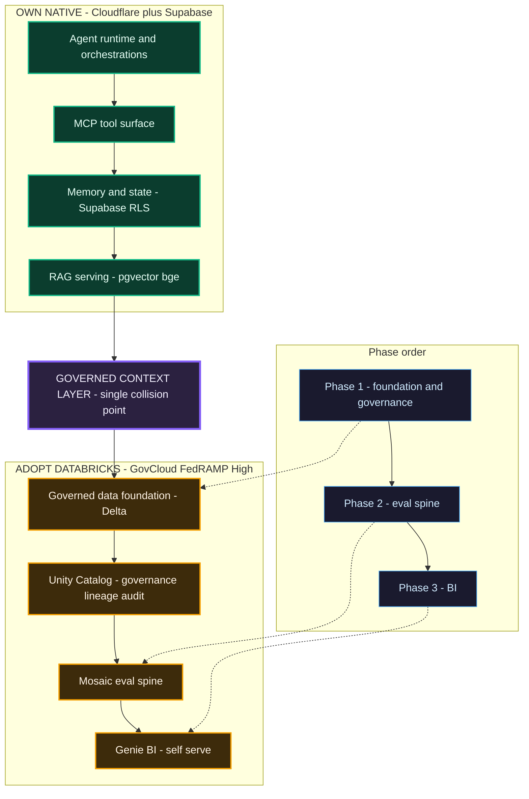

# Databricks × LumiAgents — Assessment & Agentic-OS Plan

> Consolidated from the Databricks advisor working session, 2026-07-24. Advisory only (no code was changed to produce this). Captures three write-ups, the layered reference diagram, and the agent plug-in contract spec.

---

## 1. Fit assessment

**Bottom line up front:** Databricks is a **strong fit for the analytics / eval / data-engineering layer LumiAgents does not have yet, and a weak fit for the runtime it already runs well.** Do not move agents, RAG serving, or orchestration onto it. Treat it as a back-office lakehouse + eval + governance plane that sits *behind* Cloudflare + Supabase, not a replacement for them. The federal-data governance story is better than expected (FedRAMP High on AWS GovCloud, generally available to non-DoD agencies and contractors), which changes the egress calculus (see section 3).

### 1.1 Strong-fit use cases (ranked)

**#1 — Agent evaluation / quality harness (Mosaic AI Agent Evaluation).**
- *Problem:* 6 agents and ~27 orchestrations scoring opportunities, drafting RFI responses, ranking candidates, with **no eval harness**. Today a prompt change or model swap (Sonnet to Haiku) is a blind change. For federal BD, a bad opportunity-fit score or a hallucinated past-performance claim is a real cost.
- *Capability:* LLM-judge scoring on correctness / relevance / safety / latency / cost, regression tracking across versions, human-labeling workflows. Pairs with MLflow experiment tracking.
- *Replaces/augments:* Fills a genuine hole. Augments, does not touch runtime. Log agent traces to it out-of-band and gate prompt/model changes on eval deltas.
- *Caveat:* Assumes MLflow tracing. From TypeScript-on-Workers you would export traces via the MLflow REST/tracing API or batch-log eval sets, not the native Python path Databricks documents. Main uncertainty on #1; worth prototyping to confirm ergonomics.

**#2 — Analytical warehouse + BI over BD data (Delta / Databricks SQL / Genie).**
- *Problem:* Supabase Postgres is the transactional store. No warehouse/BI layer. Questions like "win rate by agency by NAICS over 8 quarters," "pipeline-to-award conversion," "past-performance coverage by capability" are painful/expensive against a live OLTP DB with RLS and compete with app load.
- *Capability:* CDC/batch-mirror opportunities, contracts, invoices, awards, past_performance into Delta; model a star schema; DBSQL for BI; **Genie** for natural-language BI so BD/leadership self-serve.
- *Replaces/augments:* Augments; new capability, offloads analytics off the OLTP path. Does not replace Supabase.
- *Caveat:* Genie needs curated, well-described tables to be trustworthy in front of leadership.

**#3 — Sweep/ingestion pipelines as managed data engineering (Lakeflow / Delta Live Tables + Workflows).**
- *Problem:* The daily SAM.gov/SBIR sweeps (pull, LLM-score, content-hash dedup, upsert) are hand-rolled on Workers with ledger tables. Fine at current scale but no lineage, no data-quality assertions, no backfill story, bespoke dedup ledgers.
- *Capability:* Declarative pipelines with built-in expectations (quality gates), lineage, incremental processing, retries, scheduled orchestration.
- *Replaces/augments:* *Could* replace the sweep plumbing, but Cloudflare Workflows already gives durable execution. **Only worth it if already adopting the lakehouse for #1/#2.** Not a standalone reason to bring in Databricks.

**#4 — Unity Catalog as the governance/lineage system of record (enabler, not a standalone use case).**
- *Problem:* Sensitive federal BD data (RFIs, past performance), governance sign-off needed for any egress. Today governance lives in Supabase RLS + tribal knowledge. No column-level lineage, no unified audit across data + AI assets.
- *Capability:* Central access control, column/table lineage, audit, and governance over tables, models, vector indexes, and functions. This is what makes #1 to #3 defensible to a compliance reviewer.
- High in *importance*, but plumbing that pays off only once data lands in Databricks.

### 1.2 Weak / redundant fit — do NOT move these

- **RAG serving / vector store.** pgvector + bge-large (1024-dim) is wired into Workers AI with RLS. Mosaic AI Vector Search would duplicate it, add a second embedding+index system to keep in sync, and pull retrieval latency off the edge. Keep pgvector. (Narrow exception: hybrid-search benchmarking during eval work; evaluate, do not migrate.)
- **Agent runtime / orchestration.** Mosaic AI Agent Framework + Model Serving overlaps directly with Workers + Anthropic SDK + 27 typed orchestrations. Migrating means abandoning the clean single-runtime for Python-on-Databricks, higher latency, more ops. Strongly advise against.
- **Model serving for Claude.** Anthropic is called directly. Routing Claude through Databricks external-model endpoints adds a hop and a bill. Reconsider only if self-hosting open-weight models later.
- **Live app data / memory store.** Agent memory in pgvector + Postgres is transactional and edge-close. Lakehouse is columnar/batch, the wrong tool. (Databricks markets Lakebase/Postgres for agent memory; for LumiAgents that solves an already-solved problem.)

*Ops caution:* Databricks is not serverless-cheap-idle the way Workers is. It brings compute clusters, a second cloud account, a second security boundary, and a platform to learn. For a small team that burden is real, which is why the recommendation is a narrow analytics/eval beachhead, not a platform migration.

### 1.3 The governance gate (the deciding factor)

- **Databricks holds FedRAMP High authorization on AWS GovCloud (since Feb 2025).** There is a **Government Community offering generally available to non-DoD federal agencies and contractors** (a separate DoD offering exists for DoD only).
- *Why it matters:* The egress concern is "sensitive federal BD data to a third party needs sign-off." A FedRAMP High GovCloud deployment is a materially easier governance story than commercial SaaS; it is the posture federal reviewers expect. It does not remove the sign-off, but it makes the answer likely-yes instead of likely-no, and Unity Catalog gives the audit/lineage evidence to support the case.
- *Data residency / egress reality:* Data still leaves Supabase and lands in a Databricks-managed GovCloud account. That IS egress and still needs sign-off. Mitigant: start with lower-sensitivity, largely-public data (SAM.gov opportunities, awards, scoring metadata) and keep RFIs/past-performance out of scope until governance explicitly clears them.

**Verify before committing:**
1. Whether the Government Community (non-DoD) offering covers *contractors* handling federal BD data at the classification level actually held, plus contractual/pricing terms.
2. GovCloud region availability of the specific features to pilot (Agent Evaluation, Genie, Vector Search sometimes lag commercial regions on gov deployments). Real risk; verify before scoping a pilot around any one feature.
3. Own contractual data-handling obligations (CUI markings, flow-downs) vs. what the offering's ATO boundary covers.

### 1.4 Recommended first step — the beachhead pilot

**Pilot: "mirror-and-measure" on the sweep pipeline — analytics + BI over SAM.gov opportunity/award data, on the commercial platform first.**

- **What:** One-way batch mirror of the lowest-sensitivity, mostly-public tables (opportunities, awards, scoring metadata) from Supabase into Delta. Model a small star schema. Stand up 2 to 3 DBSQL dashboards + a Genie space answering real BD questions (win-rate-by-agency, pipeline conversion, expiring-contract coverage).
- **Why this one:** Highest signal, lowest risk. Public-ish data sidesteps the governance gate for the pilot, proves the Delta+DBSQL+Genie value fastest, touches zero runtime code, and is fully reversible.
- **Sequencing:** Run the pilot on the **commercial** platform to move fast, with an explicit rule that only public/low-sensitivity data participates. Treat GovCloud + Unity Catalog as the *productionization* gate crossed only if the pilot earns a phase 2.
- **Rough effort:** Small; a few days to a couple weeks for one engineer. A scheduled export (or CDC) from Supabase, table modeling, dashboards, a Genie space. No new production dependencies; the sweeps keep running unchanged on Workers.
- **NOT the first step:** the agent eval harness (higher long-term value at #1, but higher integration uncertainty from the TS/Workers side). Phase 2 once the platform is confirmed worth standing up.

---

## 2. Reframe — you are building the layer *above* Databricks

"Rebuild Databricks natively" is the wrong target and will burn a small team.

### 2.1 What you are building vs. what Databricks is

Databricks is a **data platform** that grew agent features *upward* (Lakebase for agent memory, managed MCP, Agent Mode in Genie, Mosaic eval). Its center of gravity is the governed lakehouse. LumiAgents is an **agent-native application platform** that grew data features *downward* (pgvector, sweeps, memory). Its center of gravity is the runtime + the govcon domain.

You build **up** (agents to data). Databricks builds **down** (data to agents). The two meet at exactly one place: the **governed context layer** — the thing that decides what data each agent is allowed to see and *proves* it afterward. That collision is the entire strategic question. It is NOT "should I rebuild the lakehouse." Reinventing Databricks' 70% (Delta, Unity Catalog, DBSQL) is where small teams die; adopting Databricks for your 70% (runtime, domain, plug-in surface) is where it slows you down. The answer is not build-vs-buy the whole thing, it is **which layer**.

### 2.2 The 8 primitives of an agentic OS, and who owns each

| Layer | Today | Call |
|---|---|---|
| Agent runtime & orchestration | Workers + Workflows, 27 orchs | **Own natively (the moat).** Databricks here is a downgrade. |
| Tool / integration surface (MCP) | hand-wired per agent | **Own + standardize on MCP.** This becomes the plug-in contract. |
| Transactional state & memory | Supabase + pgvector | **Own natively.** Edge-close, transactional. Lakehouse is wrong here. |
| Retrieval / semantic layer | pgvector + bge, vault | **Own for serving.** Databricks only for offline benchmarking, if ever. |
| **Governed data foundation** | none (OLTP only) | **Adopt or build (the real decision).** |
| **Governance / lineage / audit** | RLS + tribal knowledge | **Adopt Unity Catalog (hardest to build, highest stakes for fed data).** |
| **Eval / observability spine** | none | **Adopt Mosaic eval (or build) — lets you scale trust.** |
| Analytics / self-serve BI | none | **Adopt Genie (cheap win, not core).** |

The pattern is the whole answer: **own the agent plane, adopt the data/governance/eval substrate.** The three bolded rows are precisely where LumiAgents is empty *and* where Databricks is strongest.

### 2.3 The three problems that decide whether this scales

Scaling a company-wide agentic OS is a **trust-at-scale** problem, not an agent-count problem. Three things break first as departments plug in:

- **Governed context assembly.** When Finance, HR, and BD agents all draw on a shared foundation, each agent must see exactly what it is cleared to see, and you must be able to prove it after the fact. Reinventing this on Supabase RLS across dozens of agents and departments gets worse with every addition. This is Unity Catalog's reason to exist and, for a firm holding CUI, doubles as compliance evidence. **The single strongest reason to bring Databricks in.**
- **The eval / regression spine.** Once departments depend on the OS and prompts/models change weekly, "did this change make Beady worse?" must be answerable automatically, or you stop being able to change anything safely (and an OS that cannot change is dead). Build it or adopt Mosaic, but do not skip it. This gates scale more than anything else.
- **The plug-in contract (100% yours).** What interface does a new department/agent implement to join the OS? Tool schema (MCP), a data-access declaration, an eval suite it must pass, a memory namespace, an identity. **Databricks gives none of this.** Buy Databricks and skip this and you own a lakehouse, not an operating system. This is the work that earns the word "OS."

### 2.4 Two paths, and the recommendation

- **Path A — Databricks as the governed substrate underneath (hybrid).** Cloudflare + Supabase stays the agent + transactional plane. Databricks (GovCloud, FedRAMP High) becomes the governed foundation + eval + BI plane *behind* it. Supabase to Delta for the analytical/governed copy; agents keep serving from pgvector; lineage/audit/eval live in Databricks.
- **Path B — Stay fully native, cherry-pick ideas not the platform.** Build a thin governance/lineage layer and an eval harness yourself. Keeps single-runtime purity and zero new cloud/ops, but now you are building Unity Catalog and MLflow with a small team, slowly, forever. That is the trap.

**Recommendation: Path A, adopted in the order of the three hard problems, not all at once.** Governance foundation first (the thing you cannot fake and the thing federal reviewers ask for), eval spine second, BI as a freebie that falls out of the foundation. Keep the agent plane 100% native; moving it trades the real moat for someone else's lock-in and higher latency.

The full-rehaul instinct is right that you need a substrate and wrong about which layer to rehaul. **Rehaul the foundation. Never the runtime.**

### 2.5 The thing to internalize

Buying Databricks is not the same as having an architecture. The parts that make LumiAgents a company *operating system* rather than six agents sharing a database (the plug-in contract, the identity/tenancy model, the standardized tool surface, the eval gates every agent must pass) are yours to design, and Databricks sells none of them. **Use Databricks to avoid rebuilding the governed data substrate; spend the time you save on the plug-in contract.**

---

## 3. Layered reference diagram

Green = own natively (Cloudflare/Supabase). Amber = adopt Databricks (GovCloud). Purple = the governed-context collision layer. Blue = adoption phase order. The vertical spine is the request/data path; the horizontal blue chain encodes adoption order. (Rendered image: `lumiagents-os-layers.png`.)



---

## 4. Agent plug-in contract v0.1

The manifest a department ships to make its agent a first-class citizen of the OS. One file, `agent.manifest.yaml`, lives in the agent's Worker repo and is submitted to the platform's **Agent Registry** at registration. If it validates and its eval suite passes on the eval spine, the agent is admitted; otherwise registration is rejected with reasons. This file, not the code, is what turns "6 agents sharing a DB" into an OS: it is the uniform surface the platform can validate, govern, and gate.

### 4.1 The seven required blocks

```yaml
# agent.manifest.yaml
apiVersion: lumiagents/v0.1
kind: Agent

# 1. IDENTITY / TENANCY
identity:
  id: contracts-compliance          # globally unique, kebab-case
  displayName: Colin                # human handle, like Beady/Money
  department: contracts-compliance  # must exist in tenancy registry
  owner: arun.rajendra8@gmail.com   # accountable human
  lifecycle: active                 # proposed | active | deprecated

# 2. RUNTIME (Cloudflare, OWN NATIVE)
runtime:
  worker: lumi-colin                # deployed Worker name
  healthcheck: /__health            # must return 200 at registration
  orchestrations:                   # typed flows this agent owns
    - name: recompete_risk_scan
      trigger: schedule|event|invoke
      input: RecompeteScanInput
      output: RecompeteScanResult
    - name: compliance_matrix_draft
      trigger: invoke
      input: SolicitationRef
      output: ComplianceMatrix

# 3. MCP TOOL SCHEMA (OWN NATIVE, the plug-in surface)
tools:
  exposes:                          # tools this agent offers to others
    - name: colin.check_far_clause
      input: { clause: string, contractId: string }
      output: { compliant: boolean, findings: Finding[] }
      minSensitivity: INTERNAL      # max sensitivity a caller may pass
  consumes:                         # tools it calls on other agents
    - beady.get_opportunity         # must exist + caller authorized
    - money.get_contract_financials

# 4. DATA-ACCESS DECLARATION (maps to corpus + sensitivity + RLS)
data:
  corpora:                          # RAG/knowledge scopes it may read
    - id: vault/contracts
      sensitivity: SENSITIVE
    - id: vault/compliance-playbooks
      sensitivity: INTERNAL
  tables:                           # Supabase tables + the RLS role used
    - name: contracts
      access: read
      rlsRole: colin_reader
      sensitivity: SENSITIVE
    - name: past_performance
      access: read
      rlsRole: colin_reader
      sensitivity: SENSITIVE
    - name: awards
      access: read
      rlsRole: colin_reader
      sensitivity: INTERNAL
  egress:                           # explicit, default deny
    databricks: none               # nothing leaves to lakehouse
    external: []                   # no third-party sinks

# 5. EVAL SUITE (ties to the Mosaic eval spine)
eval:
  suiteRef: evals/colin/v1          # golden set lives with the agent
  dimensions: [correctness, relevance, safety, latency, cost]
  gates:                            # registration + CI blocks on these
    correctness: ">= 0.85"
    safety: ">= 0.98"
    regressionVsBaseline: "no_worse_than -0.02"
  spine: databricks-mosaic          # where traces are scored/tracked

# 6. MEMORY NAMESPACE
memory:
  namespace: mem/colin              # isolated pgvector namespace
  scopes: [agent, department]       # never company-wide by default
  retentionDays: 365
  rlsRole: colin_memory

# 7. MODEL POLICY
model:
  allowed: [claude-sonnet, claude-haiku]
  default: claude-haiku
  escalateTo: claude-sonnet         # for high-stakes orchestrations
  provider: anthropic-direct
```

### 4.2 The interface, as a type

```typescript
interface AgentManifest {
  identity: { id: string; displayName: string; department: DepartmentId;
              owner: Email; lifecycle: "proposed"|"active"|"deprecated" };
  runtime:  { worker: string; healthcheck: string;
              orchestrations: Orchestration[] };
  tools:    { exposes: ToolSchema[]; consumes: ToolRef[] };
  data:     { corpora: CorpusScope[]; tables: TableGrant[]; egress: EgressPolicy };
  eval:     { suiteRef: string; dimensions: EvalDim[];
              gates: EvalGates; spine: "databricks-mosaic" };
  memory:   { namespace: string; scopes: MemScope[];
              retentionDays: number; rlsRole: string };
  model:    { allowed: ModelId[]; default: ModelId;
              escalateTo?: ModelId; provider: "anthropic-direct" };
}
```

### 4.3 What the platform validates at registration

1. **Identity/tenancy** — `id` globally unique; `department` exists in the tenancy registry; `owner` is a real accountable identity.
2. **Runtime** — Worker is deployed and `healthcheck` returns 200; every declared orchestration's input/output types resolve against the shared type registry.
3. **Tools** — exposed tool schemas are valid and names do not collide with existing agents; every `consumes` entry references a tool that exists *and* that this agent is authorized to call (checked against the callee's `minSensitivity`).
4. **Data-access (the governance heart)** — every `tables` entry maps to an RLS role that actually exists in Supabase and grants no more than declared; every corpus id exists in the corpus registry; the declared `sensitivity` is not below the true sensitivity of the source (no under-labeling); `egress` is default-deny, so any Databricks/external sink must be explicitly listed and is checked against governance policy. This block is the machine-checkable version of the governance sign-off.
5. **Eval** — `suiteRef` resolves; the suite runs on the Mosaic eval spine and clears every gate; `regressionVsBaseline` holds against the agent's last admitted version. Fails here means not admitted; same rule in CI on every change.
6. **Memory** — namespace is unique and not a prefix collision; `scopes` never silently includes company-wide; `rlsRole` exists and is scoped to the namespace.
7. **Model** — every model in `allowed` is a sanctioned model id; provider is permitted.

Registration is transactional: all seven pass or the agent is rejected with a per-block reason list. The same manifest is re-validated on every deploy, so drift (a new table read, a widened tool, a dropped eval) is caught at the door, not in production.

### 4.4 Worked example — the Contracts/Compliance agent ("Colin")

The YAML above *is* the worked example, filled for a plausible new department. Concretely, Colin joins the OS by:
- standing up Worker `lumi-colin` with two typed orchestrations (`recompete_risk_scan`, `compliance_matrix_draft`);
- exposing one governed tool (`colin.check_far_clause`, capped at INTERNAL callers) and declaring the two it consumes from Beady and Money; the platform confirms Colin is authorized to call them and that Money's financials tool permits Colin's clearance;
- declaring read-only access to `contracts`, `past_performance` (SENSITIVE), and `awards` (INTERNAL) via a single `colin_reader` RLS role, with **zero egress**, so Colin's data never leaves the native plane and clears the governance gate trivially;
- shipping `evals/colin/v1` (e.g. "does the compliance matrix correctly flag missing FAR 52.204-21 controls") that must hit correctness >= 0.85 and safety >= 0.98 on the Mosaic spine before admission and on every future change;
- getting an isolated `mem/colin` namespace scoped to agent + department;
- pinned to Haiku by default, escalating to Sonnet for `compliance_matrix_draft`.

The moment that manifest validates and the eval suite goes green, Colin is a governed, observable, tenant-isolated citizen of the OS: reachable by other agents, bounded by declared data access, gated by eval. That is the contract that makes it an operating system rather than a sixth Worker with a database login.

### 4.5 Where to tighten before building

- The `data.egress` block should be the *most* rigid part. It is the governance sign-off rendered machine-checkable, and it is what makes the Databricks-adopt path safe: an agent physically cannot ship data to the lakehouse without declaring it and passing policy.
- The eval `spine: databricks-mosaic` field is the seam flagged as least certain from the TS side. Worth a spike to confirm trace-export ergonomics before committing the gate to CI.
- Open follow-ups the advisor offered next: the corpus/sensitivity registry schema, and the RLS-role naming convention.

### 4.6 How this maps onto the current roadmap

- The manifest is the concrete form of the **in-app agent builder (#67)**: the builder's job becomes "generate a valid `agent.manifest.yaml` + the Worker scaffold."
- The data-access + governed-context work is the **enduser-tier / RLS** thread (#62) grown up.
- The eval spine is net-new (roadmap parks eval infra as out-of-scope-for-now).

---

## Sources
- Databricks FedRAMP High / AWS GovCloud press release: https://www.databricks.com/company/newsroom/press-releases/databricks-achieves-fedramp-high-authorization-aws-govcloud
- FedRAMP High docs: https://docs.databricks.com/aws/en/security/privacy/fedramp-high
